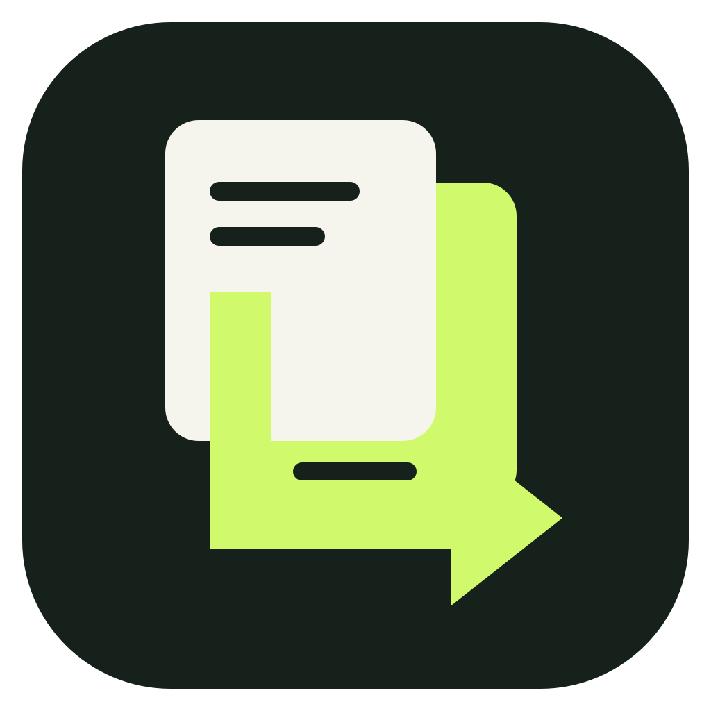
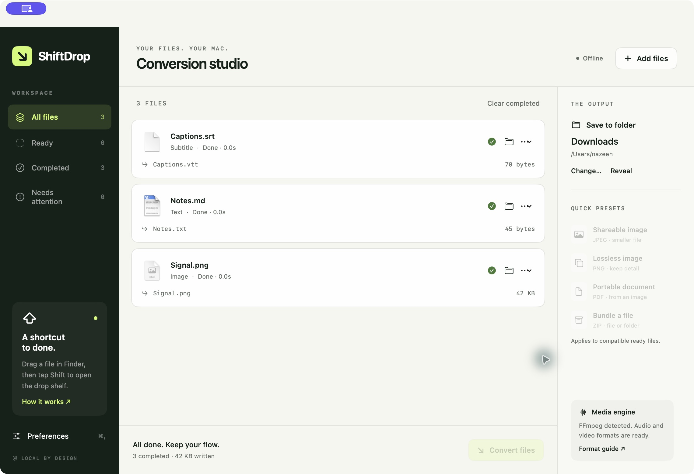
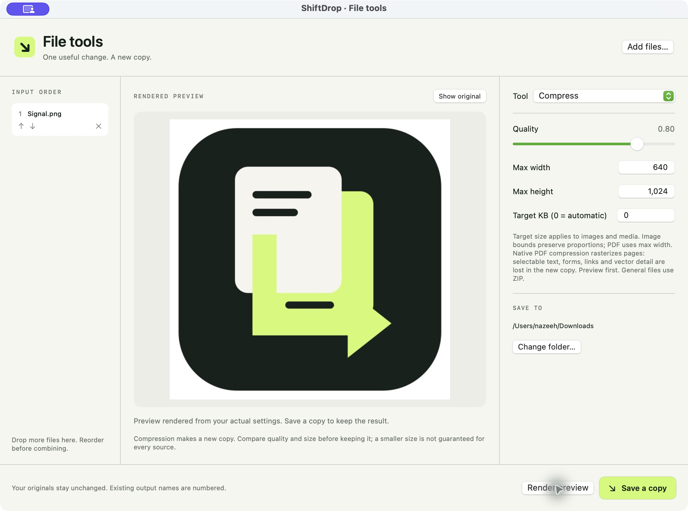

<p align="center"></p>
<h1 align="center">ShiftDrop</h1>
<p align="center"><strong>Files in. Flow out.</strong><br>A native file workbench that stays within reach.</p>
<p align="center"><a href="https://github.com/nazeeh111/ShiftDrop/releases">Mac builds</a> · <a href="#build-from-source">Build from source</a> · <a href="docs/TOOLS.md">Tool guide</a> · <a href="docs/FORMATS.md">Format guide</a></p>





ShiftDrop lives in your menu bar and opens a full studio when you need controls. Drag files, tap a modifier, and drop onto a format, tool, or file action. Convert a batch, mark up a screenshot, trim a recording, or organize a PDF without opening a web upload form.

The app processes selected files locally using macOS frameworks and optional tools already installed on your Mac. No account is required. AirDrop uses Apple's sharing service when you choose that action.

## Three ways to drop

Start dragging files from Finder, then press a modifier to bring a shelf to your pointer:

| Default modifier | Shelf | What happens after a drop |
| --- | --- | --- |
| Shift | Convert | Drop on a compatible format to start conversion. Drop on the studio queue to choose settings first. |
| Command | Tools | Open that tool with the dropped files and its controls. |
| Control | Actions | Choose AirDrop, Float, Copy files, Move, Copy paths, or Terminal. |

Change the three keys independently in Preferences. Each workflow needs a distinct key. The menu bar and **File → Show Drop Shelf** also open the shelf manually. Shortcuts read public drag and modifier state; the app does not request Accessibility or Input Monitoring access for this feature.

Quick conversions work in the background. A drop during an active conversion is queued automatically and runs after that batch. The studio keeps per-file formats, errors, retry controls, output paths, elapsed time, and a session history. Settings are captured when a batch starts.

Closing the studio keeps ShiftDrop running. With the default background preference, it leaves just the menu bar icon; later launches start there quietly. The first launch opens the studio. Launch at login is **off unless you enable it** in Preferences, and macOS may require approval in Login Items. Quit from the menu bar or with Command-Q.

## A useful editing suite

Open **File → File Tools** or drop onto a tool. The studio shows input order, a source preview, settings, and results. **Render preview** runs the actual operation into a temporary folder. **Save a copy** runs the same engine into your chosen destination. Image and PDF previews, media playback, and text reports display generated files. Changing settings invalidates the old result; render again to inspect the change.

- **Images:** crop by exact pixels or a drawn rectangle; adjust exposure, brightness, color, sharpness, noise, tone, clarity, and grain; build layered annotations with text, arrows, shapes, markers, magnifiers, image overlays, freehand paths, and highlights. Add rounded frames with solid, image, or blurred backgrounds and shadows. Cover multiple manual regions, detect faces or text locally, combine collages, or assemble images into a PDF.
- **Video:** trim, crop, change speed with matching audio timing, join ordered clips, extract frames, split at custom times, or cover a rectangle throughout a clip or within a selected interval. These operations require FFmpeg.
- **Audio:** trim edge silence, normalize loudness with a before/after measurement report, adjust mono/stereo gains, replace a selected interval with a bleep, or create a waveform video over a color or image. These operations require FFmpeg.
- **PDF:** merge files, reorder, repeat, omit, and rotate pages; inspect or edit document information; or rasterize pages for compression.
- **General:** size-aware image/media compression, metadata reports and supported metadata edits, and ZIP compression for other files or folders.

[The tool guide](docs/TOOLS.md) explains coordinates, layers, limits, output types, and controls that change meaning between tools.

## Conversion routes

Native routes cover images, PDF page rendering and selectable text, rich and plain text, Markdown, Finder text clippings, RTFD, EPUB text, subtitles, and archives. Optional FFmpeg adds media codecs and additional image encoders. Installed LibreOffice adds spreadsheet, presentation, and more Office document routes. The app offers formats according to the source type and available local engines. The decoder still validates the actual file when the job runs.

The [format guide](docs/FORMATS.md) is the detailed route reference. Material fidelity limits include:

- Apple Pages documents are unsupported. Unknown files may still be archived.
- PDF-to-document output uses selectable text. It does not reconstruct page layout, scanned text, or embedded images. PDF-to-PPTX creates one slide image per page; PDF-to-XLSX places extracted text lines into rows, without rebuilding tables or formulas.
- Delimited spreadsheet export keeps the first sheet's values. Markdown and EPUB routes reflow text rather than retaining original pagination and embedded media. Native text PDF output is a reflowed document.
- Image tools operate on still images and reject animated or multipage input. Some conversion routes export the first frame as a still image. SVG conversion rasterizes accepted artwork and rejects scripts and external resources.
- PDF raster compression creates image pages and removes selectable text, forms, links, and vector structure from the new copy. A compressed file is not guaranteed to be smaller at every quality setting.
- Automatic face/text detection can miss content. Solid image covers are flattened into new pixels; blur can leave recognizable information. Metadata removal has a defined format-specific scope and is not a complete privacy audit.

## Output and file handling

Conversion and editing create new files. Existing names receive numbered suffixes. Generated output is staged beside its destination and published with an exclusive rename that does not replace an existing path. Failure and cancellation clean up unfinished staged work; completed jobs in an earlier batch remain available. Originals are preserved by converters and tools.

**Move** is the explicit exception: it asks for a destination and confirmation, then relocates the selected originals. Copy files places file references on the clipboard for Finder to copy when pasted. Float keeps references in a small draggable shelf with left/right pinning; removing a reference does not delete its file. Terminal opens the containing folders, and AirDrop opens the system sharing flow.

The default output folder is `~/Downloads/ShiftDrop`. Conversion history and tool layers are session data. Quality, output folder, shelf keys, and background preferences are stored locally.

## Build from source

Requires macOS 13 or later and an Xcode toolchain with Swift 5.9 or newer. There are no third-party Swift package dependencies.

```sh
git clone https://github.com/nazeeh111/ShiftDrop.git
cd ShiftDrop
swift test --scratch-path /private/tmp/shiftdrop-tests
bash scripts/package.sh
open dist/ShiftDrop.app
```

The packaging script builds a release executable in a temporary directory, creates `ShiftDrop.app`, applies an ad-hoc signature, verifies that signature, and writes the app plus a ZIP into `dist/`. Temporary build staging avoids Finder metadata affecting code signing in cloud-synced source folders. The binary targets the build machine's architecture. The script does not make a universal binary.

Packaged builds are listed under [Releases](https://github.com/nazeeh111/ShiftDrop/releases). The app is **not Apple notarized**; macOS can block downloaded ad-hoc builds. Building from source is an alternative. No Apple developer credentials are included or needed for local ad-hoc packaging. Install the app in Applications before enabling launch at login.

### Optional local engines

**FFmpeg:** install a free build with the codecs you need, then reopen ShiftDrop. Discovery checks `PATH`, `/opt/homebrew/bin`, `/usr/local/bin`, `/usr/bin`, and `~/.local/bin`. Codec support depends on that executable. Media tools also need `ffprobe` beside FFmpeg or on `PATH`. FFmpeg is invoked with argument arrays and local input protocols, rather than through a shell.

**LibreOffice:** install the desktop app in `/Applications` or `~/Applications`, or provide `soffice` on `PATH`. Discovery also recognizes the existing Codex dependency override path `~/.cache/codex-runtimes/codex-primary-runtime/dependencies/bin/override/soffice`. Office helpers run with an isolated temporary profile and a macOS sandbox that denies network access; those routes require `/usr/bin/sandbox-exec`. Native text document conversion uses the macOS `textutil` helper under the same offline boundary.

ShiftDrop does not automatically download, install, or bundle either optional executable. Reopen the app after changing installed tools.

### Command line

The packaged executable converts one input without opening a window:

```sh
dist/ShiftDrop.app/Contents/MacOS/ShiftDrop --help
dist/ShiftDrop.app/Contents/MacOS/ShiftDrop --convert /path/to/photo.png --to jpeg --output /path/to/results
dist/ShiftDrop.app/Contents/MacOS/ShiftDrop --convert /path/to/captions.srt --to vtt --output /path/to/results
```

Use lowercase enum names for `--to`, such as `jpeg`, `docx`, or `tgz`. The command prints output paths on success and exits nonzero on error. The editing suite is available through the app and `ShiftDropCore`'s `ToolRequest` API; the command-line interface is for format conversion.

## Development and verification

`Sources/ShiftDrop` contains the AppKit/SwiftUI app, drag shelves, queue, file actions, and tool controls. `Sources/ShiftDropCore` contains the conversion engines, editing tools, and safe publication code. Tests generate local fixtures and inspect real outputs. The macOS CI workflow runs tests, packages the app, and uploads a build artifact without creating a release automatically.

Read [verification evidence and remaining coverage](docs/VERIFICATION.md) for checks that actually ran. A supported format or a compiled route is not a promise of identical rendering across codecs, documents, macOS versions, or hardware.

Original Swift source and graphic assets are distributed under the [MIT license](LICENSE). Apple frameworks and SF Symbols remain subject to Apple's applicable terms. The macOS-provided libarchive library, FFmpeg, and LibreOffice retain their respective licenses; optional executables are not redistributed in this repository. An installed FFmpeg build's codec choices can affect its license obligations.
