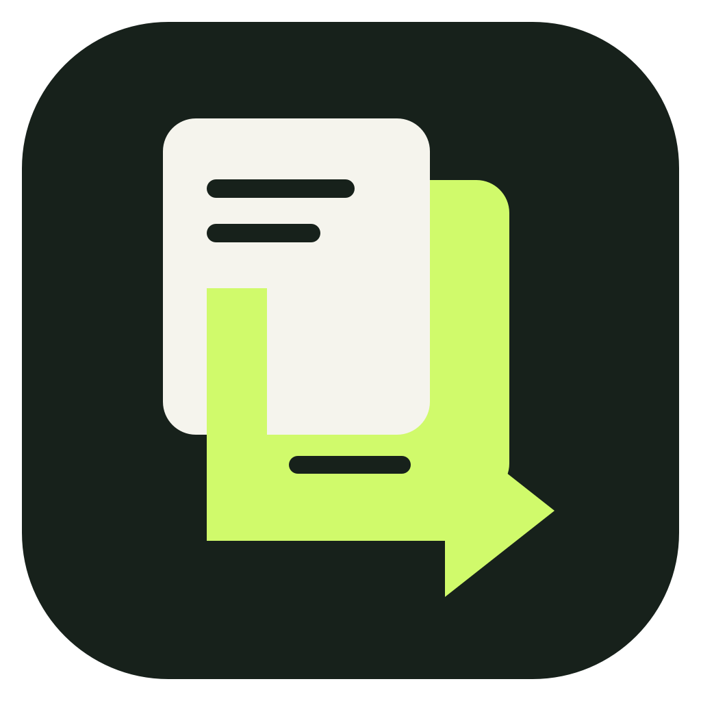
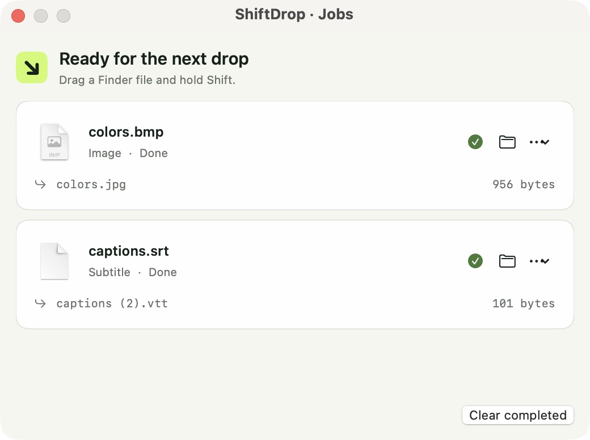
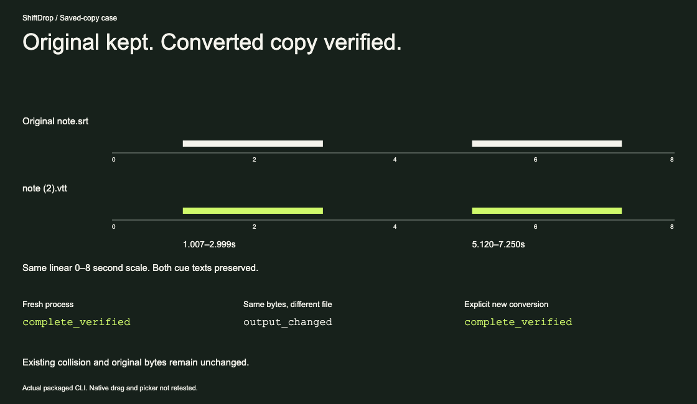

<p align="center"></p>
<h1 align="center">ShiftDrop</h1>
<p align="center"><strong>Stay in Finder.</strong><br>Drag a file. Hold Shift. Drop on its next format.</p>

A macOS menu bar utility for local file conversion and editing. A radial wheel appears at your pointer, and converted copies save beside their originals. Recent Jobs shows progress and results.



*Native fixture from the reviewed queue update, after quit and reopen. Source files and a colliding output were preserved. [Capture provenance and verification limits](docs/source-preview-capture.json).*

## Get ShiftDrop

[Download stable v0.2.0 with MIT license](https://github.com/nazeeh111/ShiftDrop/releases/download/v0.2.0/ShiftDrop-0.2.0-macOS-with-license.zip) · [Stable ZIP checksum](https://github.com/nazeeh111/ShiftDrop/releases/download/v0.2.0/ShiftDrop-0.2.0-macOS-with-license.zip.sha256) · [Try v0.2.1 Preview 1](https://github.com/nazeeh111/ShiftDrop/releases/tag/v0.2.1-preview.1) · [Build current source](#build-current-source)

Prebuilt downloads target Apple silicon and declare macOS 13 or later.

**v0.2.0** is the stable prebuilt release. It includes the Finder wheel, conversions and the Recent Jobs panel. The **0.2.1 preview** adds saved conversion batches, output verification after reopening and explicit retry for interrupted jobs. Both downloads use an ad-hoc signature and are not Apple notarized. macOS may block it. Move it into Applications, open it, then look for the menu bar icon. Launch at login stays off until you enable it.

## Drag, hold, drop

| Hold while dragging | Choose from the wheel |
| --- | --- |
| **Shift** | A compatible output format |
| **Command** | An editor with a real preview and output controls |
| **Control** | AirDrop, Float, Copy files, Move, Copy paths or Terminal |

Hold a key before a fresh drag or briefly during it. Choose a labeled sector; the center performs no operation. Escape cancels the Finder drag. Keys are configurable in Settings. You can also open a wheel from the menu bar, choose by keyboard and select files in the chooser.

Copies go beside each original, including a selection from different folders. Existing names get numbered suffixes. **Move** is an explicit action with a destination and confirmation. Closing Recent Jobs keeps active work running.

## Keep a batch, recover deliberately

The 0.2.1 preview saves conversion jobs locally. Reopening restores their state; interrupted jobs wait for explicit Retry after you restore file access. Completed recoverable outputs are checked against their retained stage and digest. A restored completion displays **Done** without inventing a new elapsed time.

Recoverable jobs use regular inputs and a single regular output up to 32 MiB, with queue and destination on the same volume. Larger inputs, directory or multiple outputs, and File Tools use labeled one-shot operations. Their interrupted work is not automatically repeated. The saved queue contains private source paths, captured input bytes and retained stages; it consumes disk space and does not restore security-scoped access automatically.

[Recovery rules and headless batch commands](docs/usage.md#resumable-conversion-batches)

### Inspect a saved-copy case

An actual packaged **0.2.1** batch converts two synthetic subtitle cues, preserves an existing `note.vtt`, and publishes `note (2).vtt`. A fresh process verifies the result. Replacing that result with byte-identical data in a different file makes its retained receipt refuse verification; an explicit new conversion creates `note (3).vtt` without replacing either prior file.

<picture><source media="(max-width:650px)" srcset="docs/presentation/copy-mobile.png"></picture>

[Native command, artifacts and limits](docs/presentation/README.md) · [Portable source and reader](docs/presentation/saved-copy.zip). This is a real windowless conversion, not a new Finder gesture capture. The retained native screenshot above keeps its original provenance; its compiled-source fingerprints match current main.


### Native follow-up

A [later controlled native run](docs/presentation/native-followup/README.md) used the shipping wheel, picker and Jobs panel to convert a synthetic subtitle, reopen its saved result, refuse malformed timing and cancel with Escape. State and callbacks were isolated in a private host; a separate exact packaged CLI process verified the GUI-created output. This adds native UI evidence without claiming Finder drag, VoiceOver or exact live-app GUI admission.


## Tools and formats

Image tools include resize, crop, adjustments, annotations, redaction and collages. PDF tools handle page ordering, merging and raster compression. Installed FFmpeg/ffprobe enable video and audio tools; installed LibreOffice adds Office routes. ShiftDrop downloads neither engine. Processing is local; AirDrop uses Apple's sharing service only when you choose it.

[Tool controls](docs/TOOLS.md) · [Conversion routes and fidelity limits](docs/FORMATS.md) · [Full installation and usage guide](docs/usage.md)

PDF compression can lose text selection, forms and vectors. Document conversions may reflow text. Detection and blur can miss sensitive content. Read the route-specific limits before using a result that needs exact fidelity.

## Build current source

macOS 13+, an Xcode toolchain with Swift 5.9+, and no third-party Swift package dependencies:

```sh
git clone https://github.com/nazeeh111/ShiftDrop.git
cd ShiftDrop
mkdir -p /private/tmp/shiftdrop-test-fixtures
SHIFTDROP_TEST_ROOT=/tmp/shiftdrop-test-fixtures swift test --scratch-path /private/tmp/shiftdrop-tests
bash scripts/package.sh
open dist/ShiftDrop.app
```

The test fixture root enables the queue and restart cases. Keep build and test paths outside cloud-synced folders. Packaging verifies the app's ad-hoc signature and writes an app and ZIP to `dist/`; the binary targets the build machine's architecture.

The packaged converter also runs without opening windows:

```sh
dist/ShiftDrop.app/Contents/MacOS/ShiftDrop --convert /path/to/photo.png --to jpeg --output /path/to/results
```

[Verification](docs/VERIFICATION.md) · [Changelog](CHANGELOG.md) · [v0.2.0 native film](https://github.com/nazeeh111/ShiftDrop/releases/download/v0.2.0/ShiftDrop-0.2.0-demo.mp4) · [Editable film source](presentation/rebuild.md)

Swift source and graphics use the [MIT license](LICENSE). Apple frameworks and optional FFmpeg/LibreOffice retain their respective terms. Optional executables are not redistributed.
