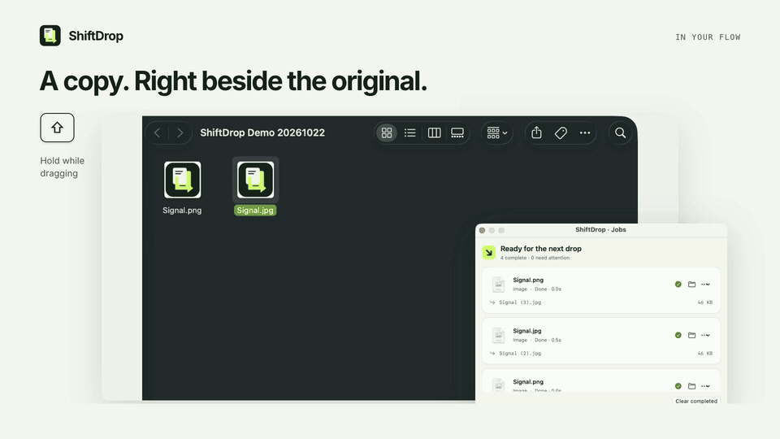

<p align="center"></p>
<h1 align="center">ShiftDrop</h1>
<p align="center"><strong>Stay in Finder.</strong><br>Drag a file. Hold Shift. Drop on its next format.</p>
<p align="center"><a href="https://github.com/nazeeh111/ShiftDrop/releases/latest">Download for Mac</a> · <a href="#install">Install</a> · <a href="docs/TOOLS.md">Tools</a> · <a href="docs/FORMATS.md">Formats</a> · <a href="CHANGELOG.md">Changes</a></p>

[](https://github.com/nazeeh111/ShiftDrop/actions/workflows/ci.yml)
[](https://github.com/nazeeh111/ShiftDrop/releases/latest)

[](LICENSE)

ShiftDrop is a background Finder file utility. It starts quietly in the menu bar, including on first launch. A radial wheel appears at your pointer when you drag files and hold a modifier. Converted copies land beside their originals. A small job panel shows progress and results.

There is no dashboard to open or Dock icon to switch to. Settings and file editors appear only when you ask for them. macOS installs the background utility in an ordinary `.app` bundle.

[](https://github.com/nazeeh111/ShiftDrop/releases/download/v0.2.0/ShiftDrop-0.2.0-demo.mp4)

[Watch the 20-second film](https://github.com/nazeeh111/ShiftDrop/releases/download/v0.2.0/ShiftDrop-0.2.0-demo.mp4) · [Editable presentation source](presentation/rebuild.md). Actual native captures with explanatory motion.

## Three gestures

| Hold while dragging | At your pointer | After you drop |
| --- | --- | --- |
| **Shift** | Compatible output formats | Convert locally and save a new copy. |
| **Command** | Tools for the selected files | Open that tool's preview and controls. |
| **Control** | Six file actions | AirDrop, Float, Copy files, Move, Copy paths or Terminal. |

Start the drag and hold a key briefly, or hold it before starting a fresh drag. Release the key and keep dragging; the wheel stays open until you drop or cancel. Move into a labeled sector to select it. The center is a safe area that performs no operation. A second ring keeps longer format lists accessible.

Change the three keys in **Settings**. The menu bar can also open each wheel manually; click a format or use arrow keys and Return, then choose files. VoiceOver can activate its labeled operations. Finder's Escape cancels an external drag; the wheel then dismisses. Reading public drag/modifier state does not require Accessibility or Input Monitoring access.

## Copies where the files are

Conversions save beside **each** original by default, including selections from different folders. Individual tool outputs follow their source folders; combined results such as collages or merged PDFs use the first source's folder. Choose a custom destination in Settings or in a tool when you want one.

Existing names receive numbered suffixes. Originals are preserved by conversions and editing tools. **Move** is an explicit exception: it asks for a destination and confirmation before relocating originals. Unfinished output is cleaned up after failures or cancellation. Closing the job panel keeps active work running; reopen it from **Recent Jobs**.

Quick drops arriving during an active conversion wait for that batch, then run automatically. Per-file formats, errors, retries and results remain available in the compact job panel for the current session. Completed copies can be revealed in Finder automatically; disable that in Settings if desired.

## Tools when you need them

Choose a tool from the Command wheel. Its editor opens with the dropped files, actual previews, input ordering and output controls. **Render preview** runs the real operation in temporary storage; **Save a copy** creates the new result.

- **Images:** resize/compress, crop, exposure/color/detail adjustments, layered annotations, backgrounds/frames, local face/text detection and manual redaction, collages and image PDFs.
- **Video:** trim, crop, speed, join, snapshots, custom splits and timed rectangular covers or blur. Requires FFmpeg and ffprobe.
- **Audio:** edge-silence trim, measured loudness normalization, mono/stereo gains, selected-interval bleeps and waveform videos. Requires FFmpeg and ffprobe.
- **PDF:** merge, reorder, repeat, omit and rotate pages; document-information edits; raster compression.
- **General:** supported metadata reports/edits, archive extraction/repacking and ZIP compression.

[Tool controls and exact limits](docs/TOOLS.md) · [Conversion routes and fidelity limits](docs/FORMATS.md)

Everything is processed locally using macOS frameworks and optional installed engines. No account is required. AirDrop uses Apple's sharing service when you explicitly choose it.

## Install

1. Download the ZIP from [the latest release](https://github.com/nazeeh111/ShiftDrop/releases/latest). The prebuilt binary is for **Apple silicon, macOS 13+**.
2. Extract it and move **ShiftDrop.app** into Applications.
3. Open it once. Look for its menu bar icon, then drag a Finder file and hold Shift.

The build is ad-hoc signed and **not Apple notarized**, so macOS may block a downloaded copy. Building from source is available below. Launch at login is off until you enable it in Settings; install in Applications first. No LaunchAgent or system daemon is installed.

### Optional local engines

**FFmpeg and ffprobe** enable media tools and extra image encoders. Discovery checks `PATH`, `/opt/homebrew/bin`, `/usr/local/bin`, `/usr/bin` and `~/.local/bin`. Codec support depends on the installed build.

**LibreOffice** enables spreadsheet, presentation and additional document routes. Discovery checks `/Applications`, `~/Applications` and `soffice` on `PATH`. Office/text helpers use isolated temporary storage and `/usr/bin/sandbox-exec` to deny network access.

ShiftDrop does not download or bundle those executables. Reopen the utility after installing them.

## Material limits

- Apple Pages documents are unsupported.
- PDF-to-document exports reflow selectable text. They do not reconstruct layout or perform OCR. PDF-to-PPTX uses page images; PDF-to-XLSX uses extracted text rows.
- Spreadsheet delimited export keeps the first sheet's values. Markdown/EPUB exports reflow text. Some image conversions use the first frame; still-image tools reject animated or multipage input.
- SVG input is rasterized after rejecting scripts and external resources.
- PDF raster compression loses text selection, forms, links and vector structure. A compressed result is not always smaller.
- Face/text detection can miss content. Blur can remain recognizable. Metadata removal has a format-specific scope, rather than being a complete privacy audit.

The guides document support rather than promising arbitrary codec/document compatibility. [Verification](docs/VERIFICATION.md) separates actual checks from untested environments.

## Build from source

Requires macOS 13+ and an Xcode toolchain with Swift 5.9+. No third-party Swift package dependencies.

```sh
git clone https://github.com/nazeeh111/ShiftDrop.git
cd ShiftDrop
swift test --scratch-path /private/tmp/shiftdrop-tests
bash scripts/package.sh
open dist/ShiftDrop.app
```

Packaging stages outside cloud-synced storage, validates the bundle, applies and verifies an ad-hoc signature, and writes an app/ZIP into `dist/`. The binary targets the build machine's architecture. The ZIP is the distributable to preserve when cloud storage adds Finder metadata to an extracted bundle.

The optional command-line converter runs without opening windows:

```sh
dist/ShiftDrop.app/Contents/MacOS/ShiftDrop --convert /path/to/photo.png --to jpeg --output /path/to/results
```

Use lowercase format names such as `jpeg`, `docx` or `tgz`. It prints result paths on success and exits nonzero on failure. File tools are exposed through the UI and `ShiftDropCore`'s `ToolRequest` API.

## Contribute

[Report a reproducible bug](https://github.com/nazeeh111/ShiftDrop/issues/new?template=bug_report.yml) with the utility/macOS versions, exact steps, expected result and input type. Share only nonprivate sample files. CI runs the test suite and packages a build; release checks are documented separately.

Original Swift source and graphics use the [MIT license](LICENSE). Apple frameworks/SF Symbols and optional FFmpeg/LibreOffice retain their respective terms. Optional executables are not redistributed. Presentation audio credits are supplied with the demo.
