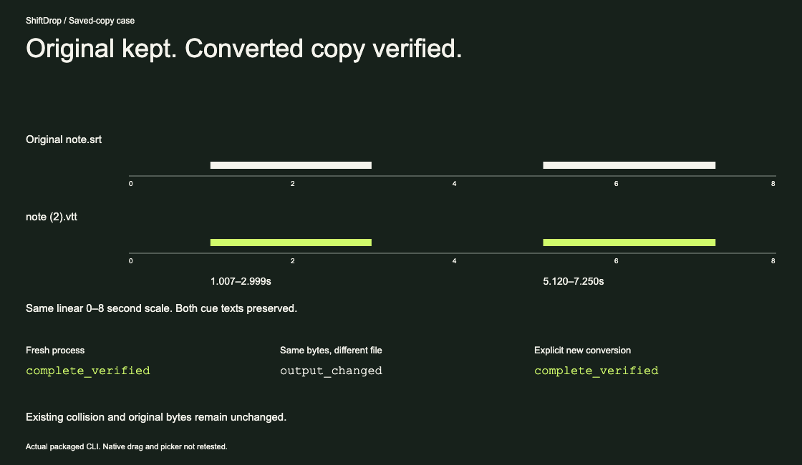

# The original stays. The saved copy has a receipt.

This case executes the actual packaged ShiftDrop 0.2.1 source-preview binary through its documented windowless commands. Inputs are two original synthetic subtitle cues. No user files, optional media engine, account, device or network is involved. The current Mac was locked; Finder drag/modifier wheel/menu/picker/VoiceOver interaction was not performed or replaced with a mock. The existing source-preview Jobs image retains its original capture record, and all 40 compiled-source fingerprints still match current main.

<picture><source media="(max-width:650px)" srcset="copy-mobile.png"></picture>

[Original SRT](note.srt) · [actual converted VTT](converted.vtt) · [preserved preexisting VTT](existing.vtt) · [native receipt](receipt.json) · [fresh status](before-status.json) · [replacement hold](held-status.json) · [explicit new conversion](new-status.json).

## What actually happened

1. An owned existing note.vtt stays unchanged. `--batch-new` captures note.srt and saves note (2).vtt. A separate `--batch-status` process reports complete_verified. Both cue texts and exact millisecond intervals survive the SRT→VTT route.
2. The retained stage and output are the same file. The case replaces only its owned output with identical bytes in a different file. Its SHA-256 still matches, but a new process reports output_changed and exits 1; `--batch-resume` exits 2 and preserves the destination. This checks the documented retained-file identity/digest contract, not arbitrary security or power-loss durability.
3. An explicitly new batch converts the untouched source again, saving note (3).vtt and verifying it in a new process. The old receipt remains held. No automatic retry/repair of the replaced output is implied.
4. A reversed-timestamp synthetic SRT is refused by `--convert` with exit 1 and leaves all prior output bytes intact. Existing unit tests separately cover pre-cancelled requests and cleanup. No new interactive Escape/picker cancellation was exercised while locked.

The figure uses the exact cue intervals on a common linear 0–8 second scale. The status cells are recorded states, not performance measurements. Source and output file hashes differ because SRT/VTT serialize timestamps differently; the original bytes are preserved separately. [Figure source](figure.py) · [mapping](figure-manifest.json).

## Read and replay

This is the extracted saved-copy reader. `python3 check.py` verifies all stored payloads, parses both cue formats and checks their timing/text equality and source-to-SVG mapping. The dedicated BUNDLE.md and complete original MIT software source are included. It is a stored-artifact reader, not a native app restore. Absolute paths and captured queue state are not published as a portable authority/backup.

For a fresh actual native replay, build current source on macOS with Xcode/Swift, following the repository setup or the included source/scripts/package.sh. Then run:

```sh
python3 replay.py --executable /path/to/ShiftDrop.app/Contents/MacOS/ShiftDrop --output /tmp/new-owned-case
```

The output directory must be new. The replay starts actual separate CLI processes, produces new queue UUIDs/paths and checks original preservation, numbered collisions, fresh-process verification, identical-byte/different-file hold and malformed-cue refusal. The archive replay was actually executed before handoff. It does not open a window, create a live user queue, restore security-scoped access or install a login item. The prebuilt v0.2.0 release does not contain this saved-batch source preview.

## Limits

Fresh-process reopen is not a power-loss experiment. Same-volume bounded regular inputs/outputs, exclusive hard-link publication, retained stages/digests and explicit permission restoration remain the original queue rules. Native file identity is separate from a byte hash; a copied file is not silently admitted as the old publication. The product code and tests are unchanged. Other conversions have their documented format/fidelity limits. No new physical-device, full native interaction, accessibility or all-format claim. Code/graphics MIT; original authorship and third-party notices remain intact.
