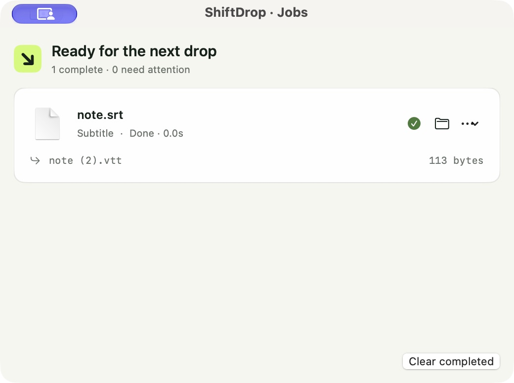

# A native result, reopened

The actual ShiftDrop Jobs panel shows a synthetic subtitle converted through its native wheel and picker. An existing `note.vtt` stays intact; the new copy is **`note (2).vtt`, 113 bytes**. Quitting and reopening the controlled native app restores its **Done** result. A separate, unmodified packaged CLI process then reports `complete_verified` for that GUI-created output.

[Exact job summary](job-summary.json) · [Capture and source provenance](provenance.json) · [Original packaged CLI case](../README.md).

## What was controlled

This is the shipping native interface and converter code, with private state injection. Of the 23 shipping Swift files, 20 remain byte-exact. Three boundary files inject memory-only preferences, a task-owned queue/destination, a fixture-only picker start and an initial Jobs window for computer-use access. Automatic Finder reveal is disabled; login-state checking is skipped. A helper class is copied from existing tests. No shipping conversion core or panel implementation changes. The complete private host is not distributed here and this page is not a standalone replay bundle.

The successful path uses the native menu/Cmd-D wheel, VTT sector, path field, Go and Add selected. The recorded intervals 1.007–2.999 s and 5.120–7.250 s and both cue texts survive conversion. Original and colliding file bytes are unchanged. The captured 0.0 s label is UI text, not a speed measurement. The actual packaged CLI separately checks retained stage/output identity and digest; it does not turn this controlled copy into exact live-app GUI admission.

## Refusal and cancellation

A second synthetic subtitle has a reversed cue. Jobs reports **Conversion failed** and explains: “Subtitle cue 1 is malformed. Use valid start/end timestamps and nonempty text.” It creates no invalid VTT and leaves the completed result intact. Opening another owned picker and pressing Escape cancels without changing the completed/failed jobs or output hashes. Cmd-Q closes the controlled app.

The first private picker setup missed a wheel entrypoint: it showed the Downloads path with a busy/empty list and was immediately cancelled before filenames or content were inspected. Every picker was then isolated centrally before the successful route. AX row clicking did not select the fixture; the native path field/Go route did. These setup limits are retained in provenance.

Finder drag/drop, VoiceOver, all appearances, every optional converter and real user permission restoration were not exercised. No user queue, private documents, system settings or accounts were used. The earlier [saved-copy reader](../saved-copy.zip) retains its original CLI-only scope and does not contain this later evidence. [MIT license](../../../LICENSE).
